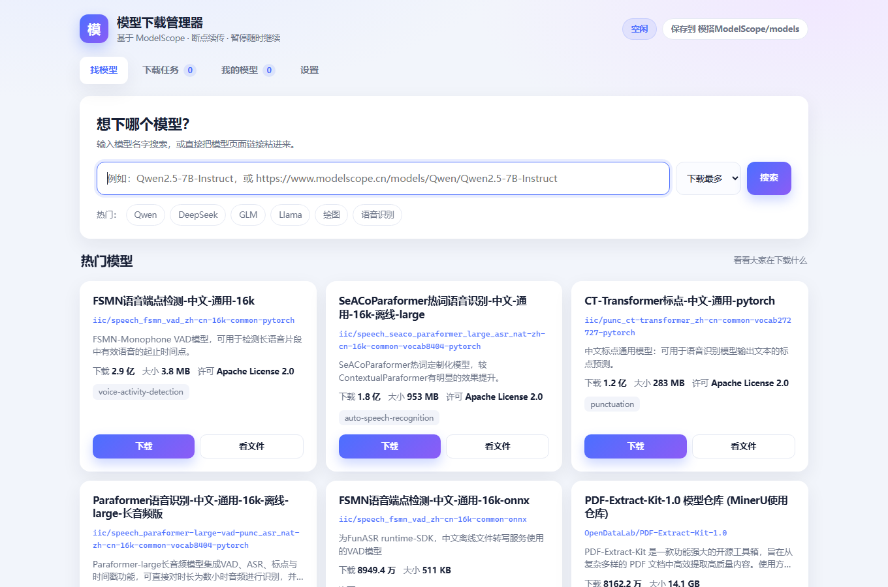
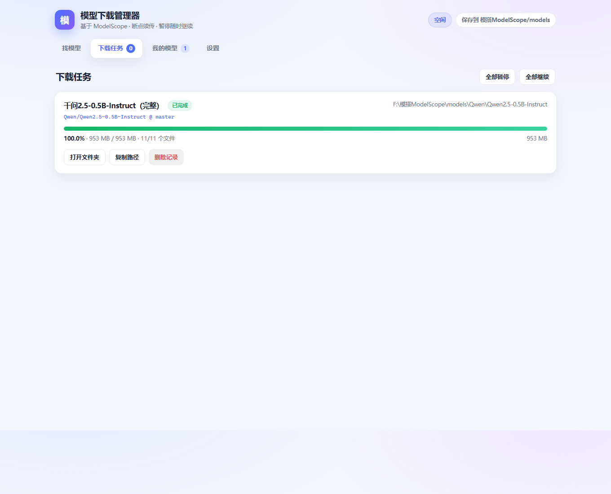
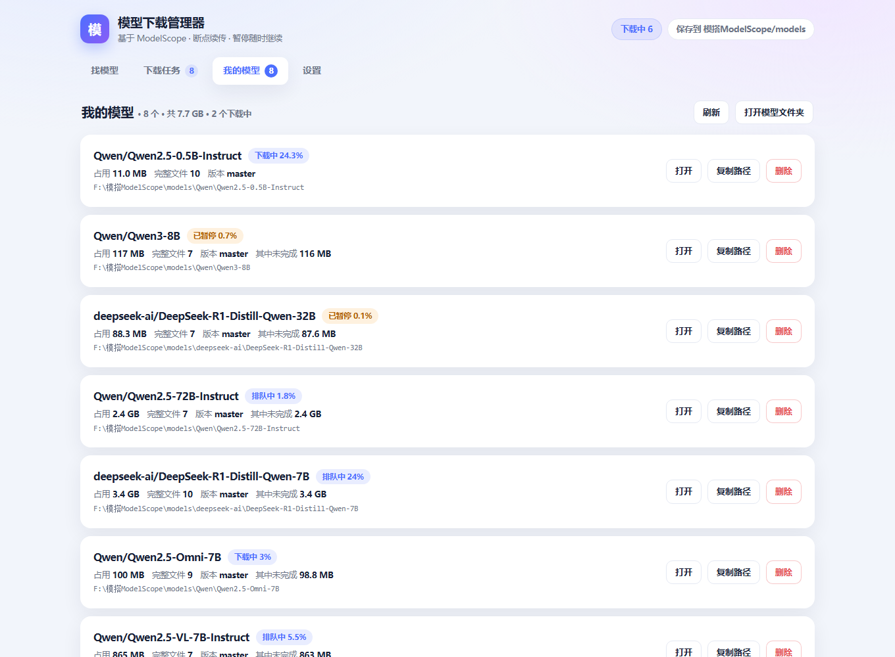

# ModelScope Model Downloader

A **double-click download manager for [ModelScope (魔搭)](https://www.modelscope.cn) models**, made for people who don't write code.

Search a model → click download → watch progress → resume whenever it breaks.



> Chinese is the primary language of this project; this file is the English mirror.

## The problem it solves

- **No coding required.** ModelScope only ships a Python API and a CLI. If you can't program, you can't easily download a model.
- **Resumable.** Power loss, closing the app, or hitting pause: the next run continues from the byte it stopped at.
- **Survives the big-file bug.** The official download library can hang when resuming a large shard (task shows "downloading", speed 0, zero bytes written). This repo ships an independent verify/repair tool that side-steps it.
- **Readable.** Live speed, ETA, downloaded/total, and the ability to pick only the file formats you need.

## Features

| Page | What it does |
|---|---|
| Find | Keyword search, paste a model page URL, or type `owner/name`; trending models on the first screen |
| Download | Pick a revision, tick individual files, one-click "safetensors only" / "gguf only" |
| Tasks | Progress bar, speed, ETA; pause / resume / cancel / retry / open folder |
| Library | Downloaded models with real disk usage, full path, copy path, delete |
| Settings | Download location, how many models at once, files per model |




## Quick start

### Option A — prebuilt exe (no Python needed)

Download `ModelScopeDownloadManager.exe` from [Releases](../../releases), put it in a folder, double-click it.
Your browser opens the UI; models are saved next to the exe in `models\`.

### Option B — from source (Windows, Python 3.10+)

1. Install Python 3.10+ and **tick "Add Python to PATH"**: <https://www.python.org/downloads/>
2. Double-click **`安装环境.bat`** — creates a virtualenv and installs dependencies
3. Double-click **`启动下载管理器.bat`** — browser opens <http://127.0.0.1:8765>

> The console window *is* the server. Closing it stops the service.
> Use **`关闭下载管理器.bat`** for a clean shutdown (also closes leftover windows).

### The batch files

| File | Purpose |
|---|---|
| `安装环境.bat` | First run: install dependencies |
| `启动下载管理器.bat` | Start (double-clicking twice won't start a second copy) |
| `关闭下载管理器.bat` | Stop service, clean leftover processes and windows |
| `检查并补齐模型.bat` | Diff against ModelScope's manifest, re-fetch missing shards |

## Where things live

```
models/<owner>/<model>/       downloaded models (default: next to the app)
data/settings.json            settings
data/tasks.json               task history
data/logs/server.log          log
```

Each finished model folder contains `.download-meta.json` (repo id, revision, file count, size).

## Why "check and repair" exists

In real use you may hit a task that fails with `_DownloadTooSlowError [E1020]`
while the same file downloads at 10 MB/s by hand. The cause is inside the
ModelScope download library: the resume path for **large shards with an existing
`.incomplete` file on disk** can stall indefinitely.

Two standalone scripts avoid that path entirely:

```bat
python app\verify_models.py     :: diff every model folder against the remote manifest
python app\repair_missing.py    :: fetch only the missing bytes (HTTP Range resume)
```

`检查并补齐模型.bat` runs both. They don't depend on the library's resume logic,
so their behaviour is predictable.

## Troubleshooting

| Symptom | Cause | Fix |
|---|---|---|
| Task stuck at 0%, speed stays 0 | the official library hangs resuming large shards | run `检查并补齐模型.bat` (bypasses the library) |
| `_DownloadTooSlowError [E1020]` | same as above (rate watchdog) | same |
| "ModelScope server is down" message | their backend is broken, not your network | retry later; the UI tells you explicitly |
| Browser can't open `127.0.0.1:8765` | service not started, or port shifted | check the address printed in the console window |
| Console window flashes and closes | dependencies missing | run `安装环境.bat` and read the error |
| Files missing after a "finished" download | shard failures | run `检查并补齐模型.bat` |
| "login required" | gated model | not supported; use ModelScope's official flow |

Logs: `data/logs/server.log`. Please paste the last few dozen lines in issues.

## Security

- Binds **127.0.0.1 only**. Do not change it to `0.0.0.0`: there is no authentication,
  yet the app exposes a delete-folder endpoint — exposing it to a LAN means handing
  out delete permissions.
- Deletion is restricted to paths inside the download directory (prefix checked).
- No account data is read or uploaded; there is no login, and nothing is written to the registry.

## Building the exe yourself

With Python 3.10+:

```bat
安装环境.bat
打包exe.bat
```

Output: `dist\ModelScopeDownloadManager.exe` (~31 MB). The first build installs PyInstaller.

## Limitations

- **Windows only** — uses `os.startfile`, `.bat` launchers and Windows path handling
- **Unofficial** — not affiliated with Alibaba / ModelScope; it uses their public HTTP endpoints, which may change
- **No login** — gated models requiring authorization are not supported
- **Models only** (`model`); datasets are not adapted

## Contributing

- Read [CONTRIBUTING.md](CONTRIBUTING.md) first — it has hard rules, especially **`.bat` files must be GBK encoded**
- Changelog: [CHANGELOG.md](CHANGELOG.md)

## Authorship

- Code: written by an **AI agent**, credited as `DEEPSEEK-V4.1-Flash 1017`
- Human: **USER wrote not a single line of code** — requirements and acceptance testing only

This project is an experiment in "non-programmer + AI" collaboration: environment setup,
UI, permission troubleshooting, diagnosing a server-side outage, and repairing missing
shards were all done by the agent.

## License

MIT — see [LICENSE](LICENSE).
