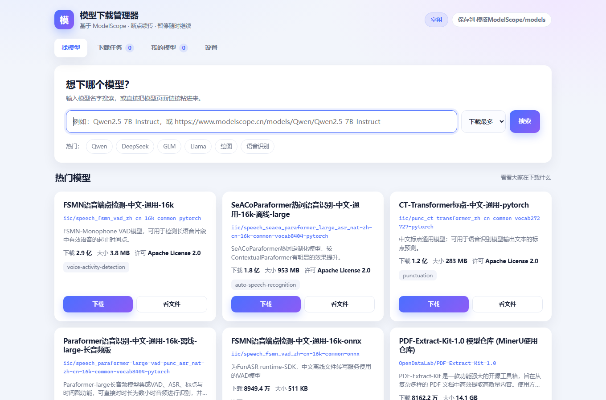
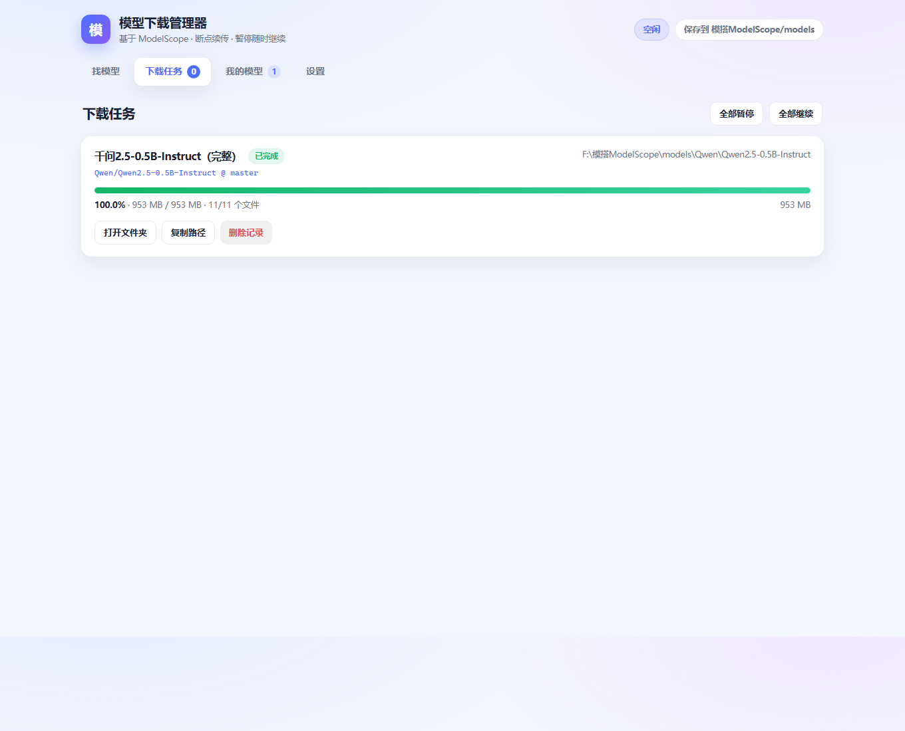
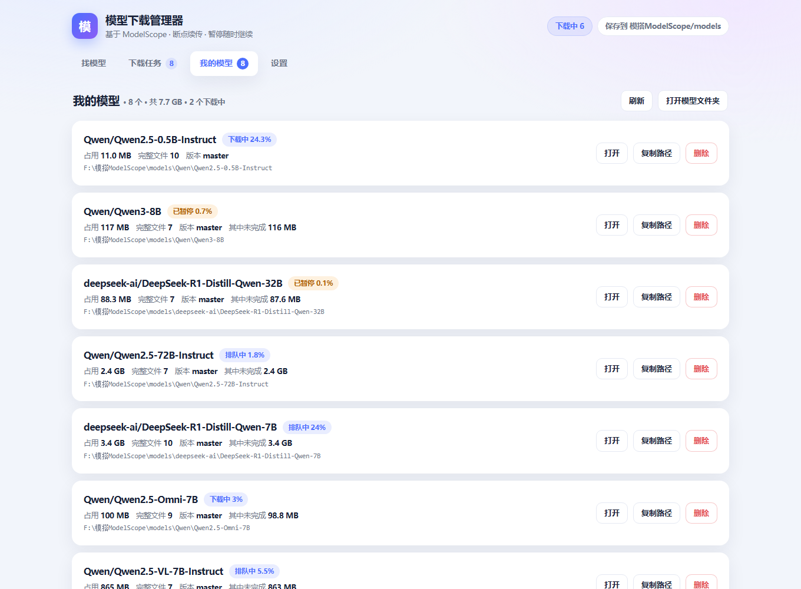

# 模搭 · 模型下载管理器

[](https://github.com/15072400099/modelscope-download-manager/actions/workflows/ci.yml)

给不写代码的人用的 **ModelScope（魔搭）模型下载器**：双击即用，不用敲任何命令。

搜模型 → 点下载 → 看进度 → 断了能续。针对官方命令行「不会用」和「大模型下载容易卡死」这两个痛点做的。



## 它解决什么问题

- **不用写代码**：魔搭官方只提供 Python API 和命令行，不会编程基本下不了模型
- **断点续传**：断电、关程序、手滑暂停，下次点「继续」接着下，不用重来
- **大文件不掉链子**：官方库在“大分片续传”场景会卡住（速度 0、一字节不写），本仓库带了独立的校验与补齐工具绕开这个坑
- **看得清**：实时速度、剩余时间、已下/总大小，还能只挑自己需要的文件格式

## 功能

| 页面 | 能干什么 |
|---|---|
| 找模型 | 关键词搜索、粘贴模型页链接、直输 `作者/模型名`；首屏展示热门模型 |
| 下载 | 选版本、勾选文件、一键「只要 safetensors / 只要 gguf」 |
| 任务 | 进度条、速度、剩余时间；暂停 / 继续 / 取消 / 重试 / 打开文件夹 |
| 我的模型 | 已下载清单、真实占用、完整路径、复制路径、删除 |
| 设置 | 换下载目录、同时下几个模型、每个模型并发几个文件 |




## 快速开始（Windows）

### 方式一：直接下 exe（不用装任何东西）

从 [Releases](../../releases) 下载 **`ModelScopeDownloadManager.exe`**，放到任意文件夹，双击即可。
浏览器会自动打开界面，模型存在 exe 旁边的 `models` 目录。

> 首次运行如果 Windows 弹「已保护你的电脑」，点「更多信息 → 仍要运行」。

### 方式二：源码运行（Python 3.10+）

1. 装 Python 3.10+（安装时**勾选 Add Python to PATH**）：<https://www.python.org/downloads/>
2. 双击 **`安装环境.bat`** —— 会自动建虚拟环境并安装 modelscope
3. 双击 **`启动下载管理器.bat`** —— 浏览器自动打开界面（默认 <http://127.0.0.1:8765>）

> 黑窗口就是程序本体，关掉它服务就停了。用完双击 **`关闭下载管理器.bat`** 更干净。

> English: see [README.en.md](README.en.md)

### 三个批处理

| 文件 | 作用 |
|---|---|
| `安装环境.bat` | 首次运行，装依赖 |
| `启动下载管理器.bat` | 启动（重复双击不会多开） |
| `关闭下载管理器.bat` | 停服务、清残留进程、关掉多余窗口 |
| `检查并补齐模型.bat` | 和魔搭清单逐个核对，缺的分片自动补 |

> 用 exe 版本时不需要这几个批处理，关掉窗口即可退出；校验/补齐功能仍然靠源码版的脚本。

## 目录结构

```
models/<作者>/<模型名>/       下载的模型（默认在程序目录下）
data/settings.json           设置
data/tasks.json              任务记录
data/logs/server.log         日志
```

每个下载完的模型目录里会有一个 `.download-meta.json`，记录仓库 ID、版本、文件数和大小。

## 故障排查

| 现象 | 原因 | 怎么办 |
|---|---|---|
| 任务卡在 0%，速度一直是 0 | 官方下载库在大分片续传时会卡死 | 双击 `检查并补齐模型.bat`，它会绕开库直接补 |
| 提示 `_DownloadTooSlowError [E1020]` | 同上（下载速率看门狗触发） | 同上 |
| 提示「魔搭服务器当前故障」 | 对方服务端出问题，不是你的网络 | 过一段时间再试，界面会直接告诉你 |
| 浏览器打不开 `127.0.0.1:8765` | 服务没启动，或换了端口 | 看黑窗口里打印的地址；端口被占用时会自动顺延 |
| 黑窗口一闪就没了 | 依赖没装好 | 双击 `安装环境.bat` 看报错 |
| `'xxx' 不是内部或外部命令` 之类乱码 | 批处理被编辑器存成了 UTF-8 | 用 git 重新检出，或按 GBK 另存 |
| 下载完发现少文件 | 分片中途失败 | 双击 `检查并补齐模型.bat` |
| 提示「需要登录授权」 | gated 模型 | 本项目不支持登录，去官网走官方流程 |

日志在 `data/logs/server.log`，报 issue 时请贴最后几十行。

### 关于 E1020 / 卡在 0% 这个坑

实测：任务报 `_DownloadTooSlowError [E1020]`，但手动请求同一文件的 URL 却有 10 MB/s。
原因是 ModelScope 下载库在**「大文件 + 磁盘上已有 `.incomplete` 半截文件」**这条
续传路径上会卡死——任务显示下载中，速度 0，一个字节也不写，重启也没用。

所以仓库里带了两个**独立于下载库**的脚本，用最原始的 HTTP Range 续传：

```bat
python app\verify_models.py     :: 逐个模型和远端清单比对，输出报告
python app\repair_missing.py    :: 只补缺的差额，已下好的不重下
```

`检查并补齐模型.bat` 就是把这两步串起来。实测补齐 13 个缺失分片、约 19 GB，
全程没有重下任何已完成的部分。

## 安全说明

- 服务**只监听 `127.0.0.1`**，外部访问不到。请勿改成 `0.0.0.0`——本程序没有鉴权，
  却带有删除文件夹的接口，暴露到局域网等于把删文件的权限开放出去
- `删除` 只能作用于下载目录内部，路径会做前缀校验，越界请求会被拒绝
- 不读取、不上传任何账号信息；不存在登录功能，也不会写注册表

## 自己打包 exe

需要 Python 3.10+：

```bat
安装环境.bat
打包exe.bat
```

产物在 `dist\ModelScopeDownloadManager.exe`。首次打包会安装 PyInstaller，
耗时几分钟，成品约 31 MB。

## 已知限制

- **仅 Windows**：用了 `os.startfile` 打开文件夹、`.bat` 启动、路径按 Windows 处理
- **非官方项目**：与阿里 / ModelScope 官方无关，使用的是其公开接口，接口变动可能导致功能失效
- **不支持登录**：需要授权的 gated 模型暂时下不了
- **只支持模型**（`model`），数据集未适配

## 反馈与建议

这个项目由作者个人维护，**不接收代码修改**（Pull Request 不会被合并）。

- 遇到问题、想提建议：开一个 [Issue](../../issues/new/choose)
- 想自己改着用：MIT 允许你 fork 任意修改，但不会合并回本仓库
- 版本变更：[CHANGELOG.md](CHANGELOG.md)
- 自己跑起来改：[CONTRIBUTING.md](CONTRIBUTING.md) 里有环境搭建方式和三个必须知道的坑（尤其 `.bat` 必须是 GBK）

## 关于作者

- 代码：**AI agent 编写**，署名 `DEEPSEEK-V4.1-Flash 1017`
- 人类：**USER 一行代码未敲**，只负责提需求和验收

这个项目是一次「非程序员 + AI」的协作试验：从装环境、写界面、排查权限问题，
到定位服务端故障和补齐缺失分片，全程由 agent 完成。

## License

MIT，见 [LICENSE](LICENSE)。
